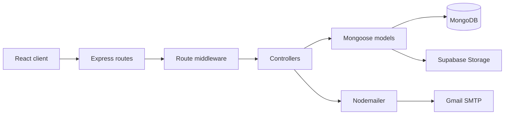
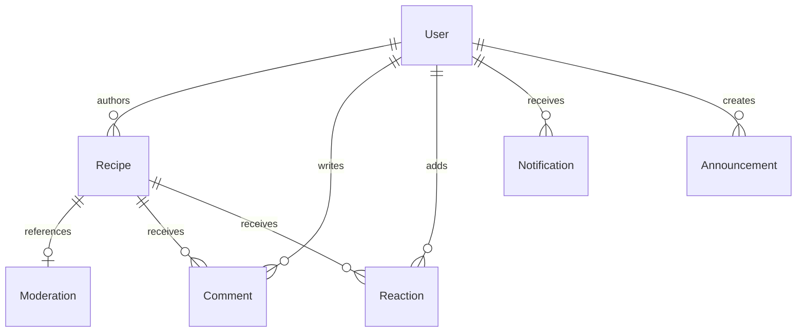

# API architecture

Documentation review date: 2026-11-09.

## System parts

The React client sends HTTP requests to the Express API. The API uses MongoDB, Supabase Storage, and Gmail SMTP.

Most application rules are static methods on the Mongoose models. Controllers call these methods and form HTTP responses.
There is no separate service directory or API gateway implementation in this repository.

## Startup and middleware

1. [server.js](server.js) loads the environment and calls `connectDB()`.
2. [database.js](src/config/database.js) connects to MongoDB.
3. The server starts the HTTP listener after the database connection succeeds.

[app.js](src/app.js) installs the middleware in this order:

1. Parse JSON request bodies.
2. Parse cookies.
3. Apply the CORS settings.
4. Write HTTP logs with Morgan.
5. Handle the root route and API routes.
6. Return the fallback 404 response.
7. Handle errors with the error middleware.

CORS permits the configured client origin and credentialed requests.
`NODE_ENV=prod` selects the production URL, database URI, cookie settings, and Morgan format.

The root route calls `initialLogin`. It can create an administrator when none exists.
It is not a read-only health check.

## Data models

Read [src/models](src/models) for complete field definitions and model methods.

| Model | Main fields and function |
| --- | --- |
| `User` | Account email, hashed password, role, profile, verification flag, and `deletedAt`. |
| `Recipe` | Author, title, category, province, media URLs, ingredients, procedure, and moderation reference. |
| `Moderation` | Recipe reference, moderator reference, status, notes, and `deletedAt`. |
| `Reaction` | Recipe reference, user reference, reaction value, and `deletedAt`. |
| `Comment` | Recipe reference, author reference, content, and `deletedAt`. |
| `Notification` | Recipient, actor, recipe reference, type, content, read flag, and `deletedAt`. |
| `Announcement` | Title, content, author, active flag, and `deletedAt`. |
| `PostView` | Recipe reference, visitor type, user or guest identifier, and timestamps. |
| `PlatformVisit` | Visitor type, user or guest identifier, and timestamps. |
| `ResendAttempt` | Email, request type, attempt count, and last attempt time. |
| `ResetToken` | User reference, token, expiry time, and used flag. |

The `User` roles are `admin`, `creator`, and `user`.
The recipe categories are `dishes`, `soup`, `drinks`, `desserts`, and `pastries`.
The reaction values are `heart`, `drool`, and `neutral`. The reaction schema also permits `null`.
The moderation states are `pending`, `approved`, and `rejected`.

### Relationships

This diagram describes intended references. It does not assert database constraints for each relationship.
`createRecipe()` creates the recipe before its moderation record. The method does not use a database transaction.

### Recipe fields

The ingredient schema stores `quantity` as a number. The request validation schema requires a string quantity.
Use string quantities in requests. Mongoose converts the values when it stores them.

Each procedure step has `stepNumber` and `content`.
The recipe also has a `status` field, but recipe list queries use the related moderation status.
Do not use the recipe `status` field alone to determine approval.

## Registration flow

1. `POST /api/auth/register` calls the authentication controller.
2. `User.signup()` does a check of the registration fields and creates the account.
3. The user save hook hashes the password with bcrypt.
4. The controller sends a verification email.
5. The controller sets an authentication cookie.

The login method does a check of the email and password. It does not require `isEmailVerified=true`.
Email delivery can fail after the account exists.

## Recipe flow

1. The route does a check of the authentication cookie.
2. Multer reads the multipart fields and files into memory.
3. `Recipe.createRecipe()` parses the ingredient and procedure strings.
4. The storage helper transfers supplied media to Supabase.
5. The method does a check of the recipe fields and creates the recipe.
6. The method creates a pending moderation record.
7. The method stores the moderation reference on the recipe.
8. The method creates a notification for the author.
9. The controller returns HTTP 201 with the recipe in `result`.

Media transfer occurs before some database checks. A later failure can leave files in storage.
The update method can delete old media before the update completes.

## Moderation and notifications

The moderation route permits `admin` and `creator` roles. The model prevents a moderator from moderating their own recipe.
An accepted change updates the moderation record and calls the notification model.
Recipe updates reset the related moderation record to `pending`.

Notification methods write MongoDB documents during application requests.
The API has endpoints to retrieve notifications and change their read state.
The repository has no WebSocket server, event queue, or push notification transport.

## Authentication and access

[authenticateUser.js](src/middleware/authenticateUser.js) reads only the `kulinarya_auth_token` cookie.
It verifies the JWT and assigns the decoded payload to `req.user`.
The payload includes a user ID and role. The middleware does not load the account for each request.

The optional variant accepts a request without a cookie. It still rejects an invalid cookie token.
[checkRole.js](src/middleware/checkRole.js) does a check of the token role where a route installs it.
Some models also do a check of record ownership.

The cookie lasts seven days. In `prod` mode, it uses `httpOnly`, `secure`, and `sameSite: "none"`.
Other modes use `httpOnly`, `secure: false`, and `sameSite: "lax"`.

Access checks differ between routes. For example, the user list requires authentication but has no administrator role check.
Read the [API reference](API_DOCUMENTATION.md) before you make access claims.

## Storage and email

[handleSupabaseUpload.js](src/utils/handleSupabaseUpload.js) uses the hardcoded bucket `kulinarya-bucket`.
It creates names with a UUID and obtains a public URL.
The media folders are `profile_pictures`, `recipe_pictures`, and `recipe_videos`.

Multer accepts JPEG, JPG, PNG, WebP, and MP4 MIME types. Its limit is 50 MiB per file.
Model calls specify smaller picture limits. See the [upload table](API_DOCUMENTATION.md#media-uploads) for the effective configuration and known defect.

[emailTransporter.js](src/utils/emailTransporter.js) uses `smtp.gmail.com`, `GMAIL_USER`, and `GMAIL_PASS`.
The mail functions create links from the selected `CLIENT_URL`.
There is no Resend service integration.

## Queries and performance

[aggregationPipelines.js](src/utils/aggregationPipelines.js) builds MongoDB aggregation stages.
Recipe methods combine recipe, author, moderation, reaction, comment, and view data.
Recipe lists use page numbers. Comments, reactions, and notifications use timestamp cursors.

The user email field has `unique: true`.
The platform visit model defines three compound indexes with `createdAt`.
The source does not define the recipe and moderation indexes that older guides described.

The API has no application cache, Redis client, image compression step, or chunked upload implementation.
The storage helper sets `cacheControl: "3600"` for stored objects. This setting is not an API response cache.

## Logs and deployment boundaries

Morgan writes request logs. The application also uses `console` statements.
Some statements include the database URI, registration input, or recipe data.
Review those statements before you collect or share logs.

The application prints a message every 30 seconds. This message does not test service health.
No dedicated health route, metrics exporter, process supervisor, reverse proxy, or CI pipeline is supplied.

Use [Deployment](DEPLOYMENT.md) for runtime configuration.
Use the [implementation gaps](API_DOCUMENTATION.md#implementation-gaps) for known source conflicts.
